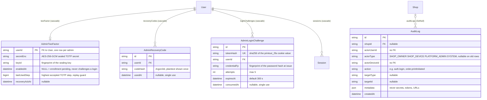

# ER: admin and security

Models: `AdminTwoFactor`, `AdminRecoveryCode`, `AdminLoginChallenge`, `AuditLog` (+ `User`, `Shop`, `Session` for context).

## Constraints

| Table | Unique | Foreign keys (onDelete) | Indexes |
|---|---|---|---|
| AdminTwoFactor | `userId` (PK) | `userId → User` (Cascade) | |
| AdminRecoveryCode | none | `userId → User` (Cascade) | `(userId, usedAt)` |
| AdminLoginChallenge | `tokenHash` | `userId → User` (Cascade) | `userId`, `expiresAt` |
| AuditLog | none | `shopId → Shop` (SetNull) | `(shopId, createdAt)`, `createdAt` |

## Security design recorded in the schema

- **Admin boundary:** `Role.PLATFORM_ADMIN` vs `SHOP_OWNER` on `User.role`. Admin routes sit behind `adminGuard` (role check + CSRF on mutations). Admins have no `shopId`; they can read **metadata only**: the admin API never returns filenames, object keys, tracking tokens or document URLs.
- **2FA (TOTP):** an enrolled admin's `passwordHash` is stored with a `tfa1$` prefix ("rollback guard": an older API that does not understand 2FA fails closed instead of accepting the password alone). A password-verified sign-in only yields an `AdminLoginChallenge`, which is **not** a session; any route that does not look for the challenge cookie rejects it.
- **Platform admins can never sign in through the mobile `POST /auth`, Google, or phone paths** (`403 FORBIDDEN`): the Android app is for shop owners only.
- **AuditLog** rows are only ever created by application code (no route or worker updates or deletes them); every sensitive mutation writes a row inside its transaction. Metadata is explicitly free of secrets (phone and email are masked, e.g. `+91••••••••10` and `a***@gmail.com`).
- Suspension (`PUT /admin/shops/:id` with `status: SUSPENDED`) invalidates all `Session` rows of the shop's users and revokes their `RefreshToken`s in one transaction; devices of a suspended shop get `403 SHOP_SUSPENDED`.
