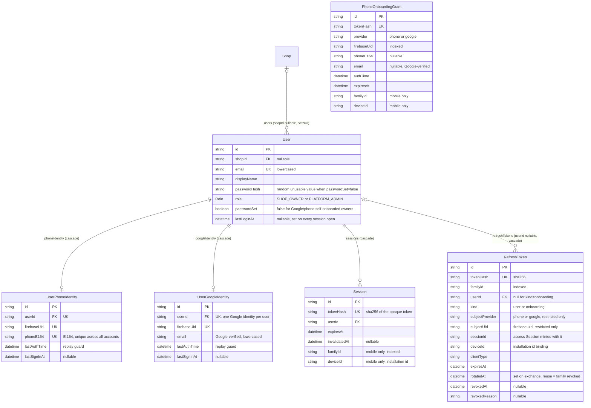

# ER: authentication and identity

Models: `User`, `UserPhoneIdentity`, `UserGoogleIdentity`, `Session`, `RefreshToken`, `PhoneOnboardingGrant` (plus `Shop` for context). Admin 2FA tables are in [er-admin-security.md](./er-admin-security.md); push registrations in [er-notifications.md](./er-notifications.md).

## Constraints

| Table | Unique | Foreign keys (onDelete) | Notable indexes |
|---|---|---|---|
| User | `email` | `shopId → Shop` (SetNull, nullable) | |
| UserGoogleIdentity | `userId`, `firebaseUid` | `userId → User` (Cascade) | |
| UserPhoneIdentity | `userId`, `firebaseUid`, `phoneE164` | `userId → User` (Cascade) | |
| Session | `tokenHash` | `userId → User` (Cascade) | `userId`, `familyId` |
| RefreshToken | `tokenHash` | `userId → User` (Cascade, nullable) | `familyId`, `userId`, `subjectUid`, `expiresAt` |
| PhoneOnboardingGrant | `tokenHash` | none | `familyId`, `firebaseUid`, `expiresAt` |

## How the pieces fit

- **Web session:** `Session` row (no `familyId`/`deviceId`); the cookie holds the raw token, the DB holds only `sha256(token)`. TTL `SESSION_DAYS` (7).
- **Mobile session:** the **access token is a `Session`** with `familyId` + `deviceId` and a short TTL (`ACCESS_TOKEN_TTL_MINUTES`, 15). The **refresh token is a `RefreshToken`** in the same `familyId`, single-use, rotated on every `POST /auth/refresh`. Two different secrets, both stored only as SHA-256 hashes.
- **Restricted principal** (verified Firebase Google/phone identity with no account): `PhoneOnboardingGrant` (the raw value *is* the access token on mobile) + a `RefreshToken` with `kind = 'onboarding'` and `userId = null`. It can only call `POST /shops/onboarding`, `GET /users/me` and logout. After a successful onboarding the onboarding refresh row is revoked with reason `onboarded` and the app receives a normal pair.
- **Identity resolution is by Firebase uid only:** `UserGoogleIdentity.firebaseUid` / `UserPhoneIdentity.firebaseUid`. A matching email or phone never links or signs in an account; linking is an explicit, re-authenticated owner action.
- `Shop.users` can hold several users, but the business rule is one `SHOP_OWNER` per shop (`GET /shops/me` returns the oldest owner as `ownerId`).

## Not in this diagram

The Firebase ID token, Firebase's own refresh token and the FCM token are **never stored** as such (FCM tokens are stored encrypted, see notifications). The Firebase Admin SDK verifies ID tokens server-side; nothing about a Firebase session lives in these tables except `firebaseUid`.
