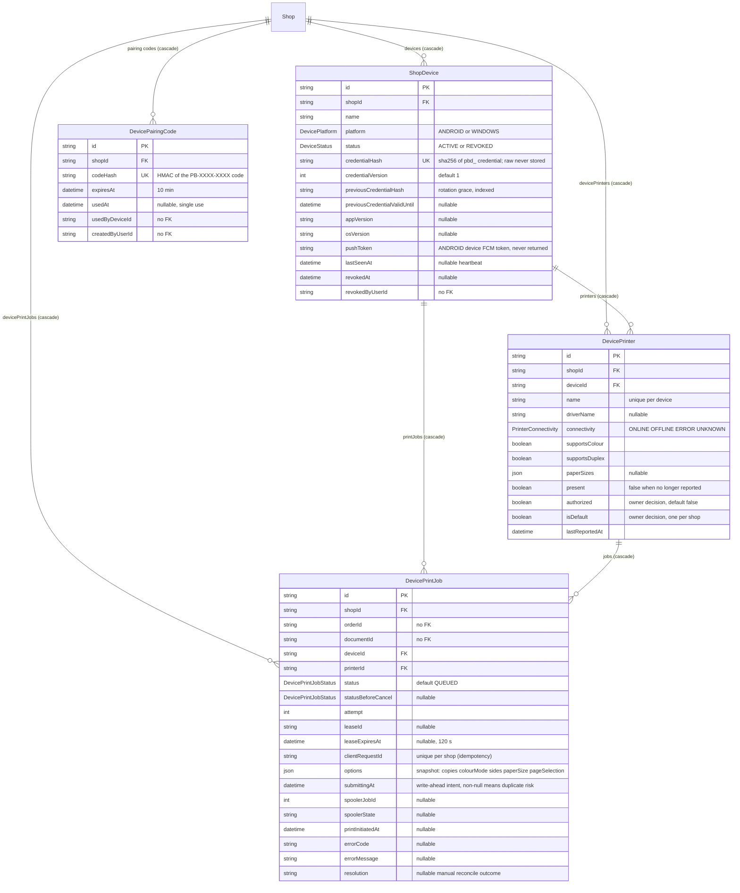
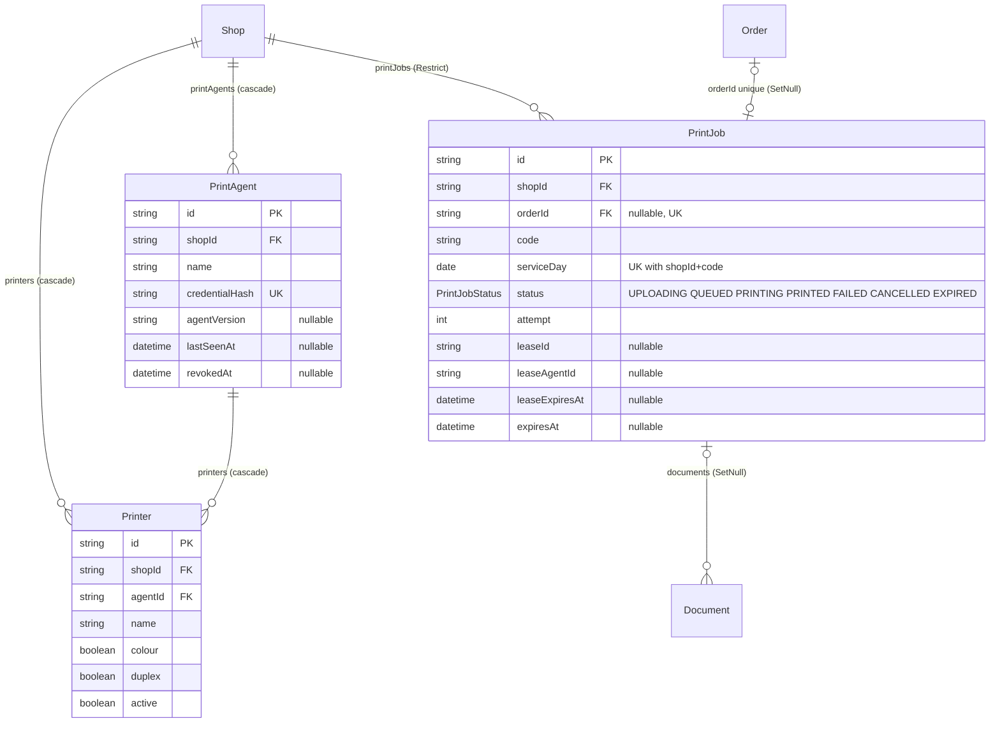
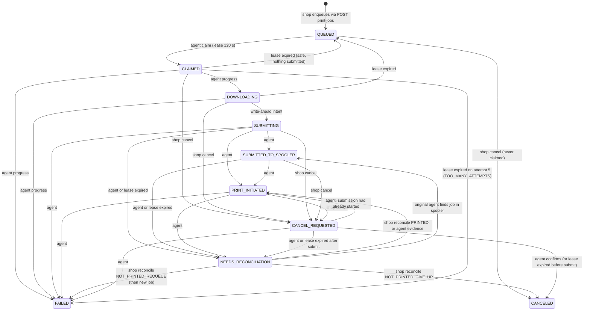

# ER: devices, printers and print jobs

Two parallel model families exist. **Only the first is live:**

| Family | Models | Status on `main` |
|---|---|---|
| **Device foundation + Windows agent** | `ShopDevice`, `DevicePairingCode`, `DevicePrinter`, `DevicePrintJob` | **In use** (pairing, heartbeat, printers, claim/progress, shop queue) |
| **Target architecture** | `PrintAgent`, `Printer`, `PrintJob` | **Schema only**: no route/worker touches them |

Schema-only target tables (not used):

## Constraints

| Table | Unique | Foreign keys (onDelete) | Indexes |
|---|---|---|---|
| ShopDevice | `credentialHash` | `shopId → Shop` (Cascade) | `(shopId, status)`, `previousCredentialHash` |
| DevicePairingCode | `codeHash` | `shopId → Shop` (Cascade) | `(shopId, expiresAt)` |
| DevicePrinter | `(deviceId, name)` | `shopId → Shop`, `deviceId → ShopDevice` (Cascade) | `(shopId, isDefault)` |
| DevicePrintJob | `(shopId, clientRequestId)` | `shopId → Shop`, `deviceId → ShopDevice`, `printerId → DevicePrinter` (all Cascade) | `(shopId, orderId)`, `(deviceId, status)`, `(shopId, status, createdAt)` |
| PrintAgent / Printer / PrintJob | `credentialHash` / none / `orderId`, `(shopId, serviceDay, code)` | see diagram | |

## Print-job state machine (`DevicePrintJobStatus`)

There is **deliberately no "PRINTED" state**: neither the spooler nor the platform can confirm paper. `PRINT_INITIATED` means "the spooler accepted the job and began processing it". Any job that may have reached the spooler is never auto re-queued: ambiguity ends in `NEEDS_RECONCILIATION` and a human decides.

Constants (from `domain/print-jobs.ts`): lease 120 s, max 5 attempts (then `FAILED TOO_MANY_ATTEMPTS`), document download URL ≤120 s, one in-flight job per device, blocking statuses (`QUEUED, CLAIMED, DOWNLOADING, SUBMITTING, SUBMITTED_TO_SPOOLER, CANCEL_REQUESTED, NEEDS_RECONCILIATION`) block another job for the same order (`409 ACTIVE_PRINT_JOB_EXISTS`).

## Android relevance

An **Android phone running the owner app** uses a *user* bearer token and never creates `ShopDevice` rows. `ShopDevice.platform = ANDROID` exists for a **paired companion device** (pairing code → `pbd_` credential → `/device/*`). The print queue (`DevicePrinter`/`DevicePrintJob`) is Windows-only: Android devices get `409 CONFLICT` on printer/print-job device routes.
