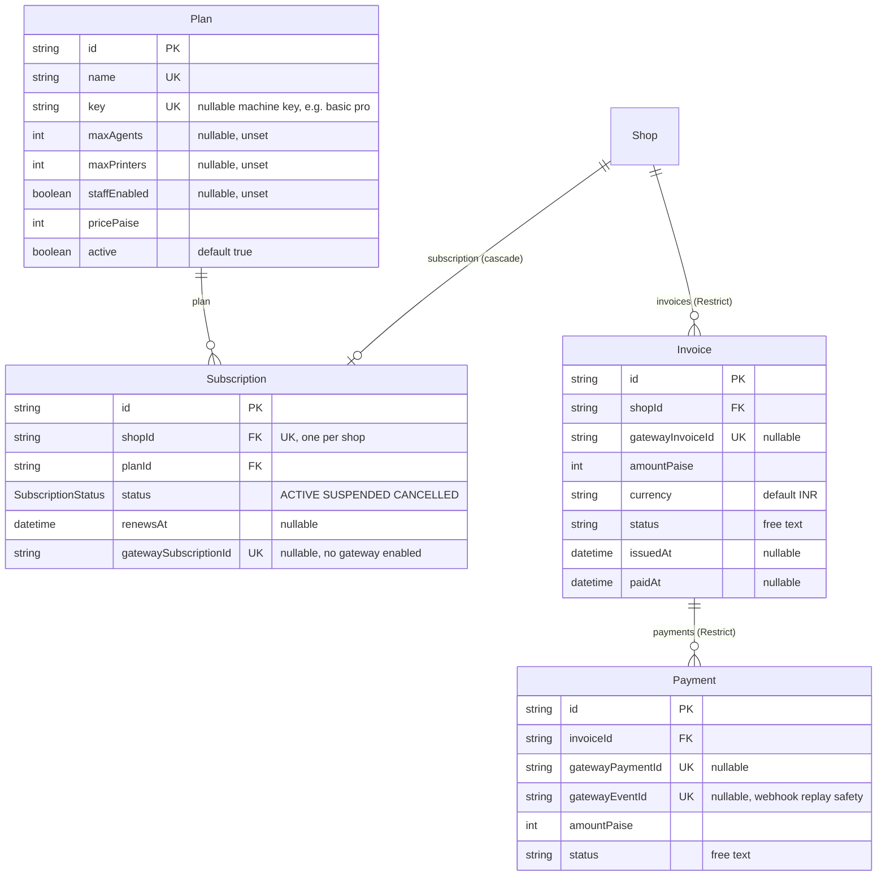

# ER: legacy billing (plans, subscriptions, invoices, payments)

**The platform is free** (PR #40): no payment is taken, there is no checkout and no customer-facing billing API. These tables are retained for compatibility and a future decision.

| Model | Used by code? | How |
|---|---|---|
| `Plan` | Yes (admin only) | `GET/POST/PUT /admin/plans` |
| `Subscription` | Yes (admin + gate) | `GET /admin/subscriptions`, `PUT /admin/subscriptions/:shopId`; the **public-intake and device gate** treats *no subscription* or `ACTIVE` as allowed (`domain/eligibility.ts`) |
| `Invoice` | **No** | schema only |
| `Payment` | **No** | schema only |

## Constraints

| Table | Unique | Foreign keys (onDelete) |
|---|---|---|
| Plan | `name`, `key` | none |
| Subscription | `shopId`, `gatewaySubscriptionId` | `shopId → Shop` (Cascade), `planId → Plan` (no action) |
| Invoice | `gatewayInvoiceId` | `shopId → Shop` (Restrict) |
| Payment | `gatewayPaymentId`, `gatewayEventId` | `invoiceId → Invoice` (Restrict) |

## Notes for the Android developer

- **Do not build billing UI.** `ShopProfile.status` (`standard`/`premium`) and `plan` in `GET /shops/me` are derived from `Subscription`/`Plan` and are `standard` / `null` for every self-onboarded shop.
- **Revenue in the app is estimated order value only** (`GET /shop/analytics*`): customer payments are cash at the counter and are not recorded anywhere. `Payment`/`Invoice` say nothing about customer orders.
- An admin can still create a subscription for a shop; a `SUSPENDED` or `CANCELLED` subscription makes the shop reject new customer intake (`409 SHOP_UNAVAILABLE`) and makes its paired devices answer `403 SUBSCRIPTION_INACTIVE`.
