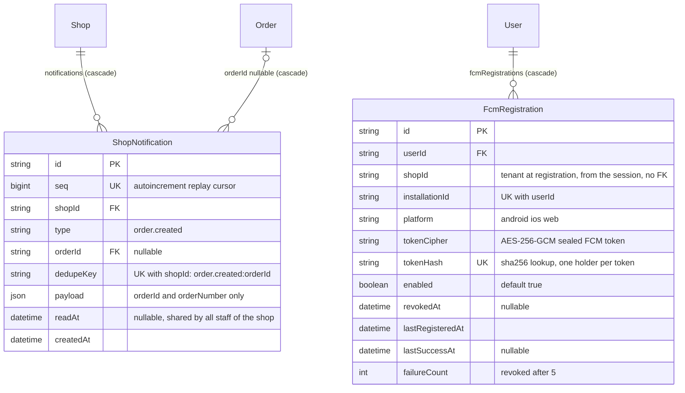

# ER: notifications (in-app inbox, SSE, FCM)

Models: `ShopNotification` (durable inbox/outbox) and `FcmRegistration` (push targets). Also touching: `ShopDevice.pushToken` (device-credential push for paired Android devices, a separate mechanism).

## Constraints

| Table | Unique | Foreign keys (onDelete) | Indexes |
|---|---|---|---|
| ShopNotification | `seq`, `(shopId, dedupeKey)` | `shopId → Shop` (Cascade), `orderId → Order` (Cascade) | `(shopId, seq)`, `(shopId, readAt)`, `createdAt` |
| FcmRegistration | `tokenHash`, `(userId, installationId)` | `userId → User` (Cascade) | `shopId` |

## Delivery model

1. `POST /public/shops/:slug/orders` writes the `Order` **and** its `ShopNotification` row in the **same transaction** (transactional outbox; `dedupeKey` makes it idempotent). Committed order ⇔ committed notification.
2. After commit, three best-effort signals fan out: (a) the SSE hub (`notification.created` + `order.created`) for open `/shop/events` streams, (b) **FCM push** to the shop owners' registered installations (payload `{ type: "order.new", orderId }` plus a generic title: no file names, customer data, URLs or tokens), (c) the device notifier for paired Android devices (`NEW_PRINT_REQUEST`).
3. **The database is the source of truth.** A client that missed SSE/push recovers with `GET /shop/notifications?after=<lastSeq>` (and `GET /shop/orders`). Notifications are hidden after `NOTIFICATION_RETENTION_DAYS` (14) and swept by the worker.

## FCM rules

- Registration is **per (user, installation)**: `PUT /users/me/fcm-token` upserts; the same token presented under another account/installation revokes the older registration.
- The token is stored **only** encrypted (`tokenCipher`) plus a SHA-256 `tokenHash`; it is never returned by any API, never logged and never put in audit metadata.
- Push is sent only to registrations of **this shop** whose user is still a `SHOP_OWNER` of that shop; permanent FCM errors (`registration-token-not-registered`, `invalid-registration-token`, `invalid-argument`) revoke immediately; transient failures count up to `FCM_FAILURE_REVOKE_AFTER` (5). Registrations unused for `FCM_STALE_DAYS` (60) are ignored and swept.
- Logout / logout-all / refresh-family revocation removes the installation's registration (logout-all can keep push with `keepPush: true`).
- Whether push is actually enabled in production (`FCM_PUSH_ENABLED`, default **false**) and whether `FIREBASE_PROJECT_ID` is set is **Requires confirmation** (production env is not in the repository).
