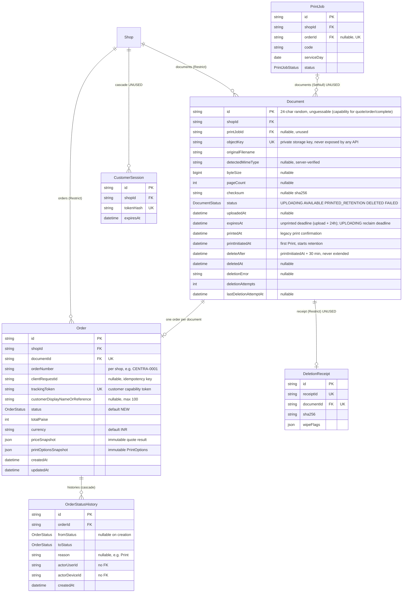
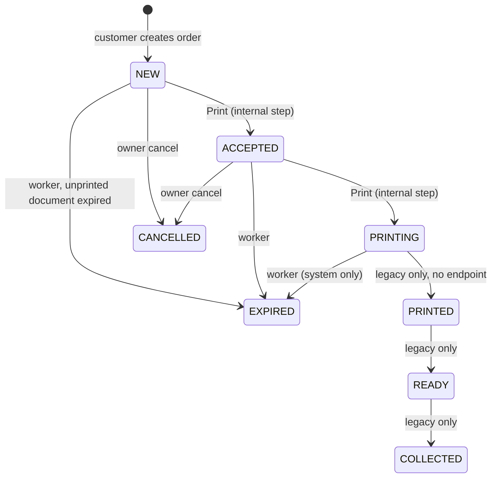
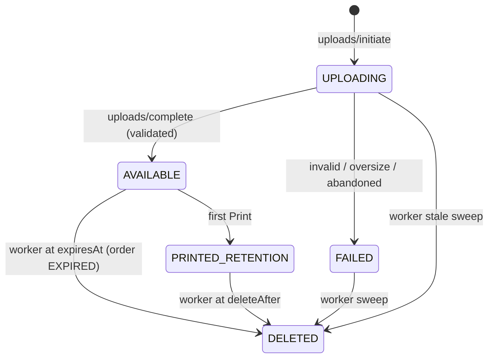

# ER: orders and documents

Models: `Order`, `OrderStatusHistory`, `Document`, plus the schema-only `DeletionReceipt`, `CustomerSession`, `PrintJob` (shown dashed in prose, drawn normally below). Device print dispatch is in [er-devices-printers.md](./er-devices-printers.md).

## Constraints

| Table | Unique | Foreign keys (onDelete) | Indexes |
|---|---|---|---|
| Document | `objectKey` | `shopId → Shop` (Restrict), `printJobId → PrintJob` (SetNull) | `(shopId, status)`, `(status, deleteAfter)`, `(status, expiresAt)`, `(status, createdAt)`, `printJobId` |
| Order | `documentId`, `trackingToken`, `(shopId, orderNumber)`, `(shopId, clientRequestId)` | `shopId → Shop` (Restrict), `documentId → Document` (no action) | `(shopId, status, createdAt)`, `(shopId, createdAt)` |
| OrderStatusHistory | none | `orderId → Order` (Cascade) | `(orderId, createdAt)` |

`(shopId, clientRequestId)` is the order-creation idempotency key (a NULL `clientRequestId` never collides). `documentId` unique enforces **one order per document**.

## Lifecycles

**Order status** (`OrderStatus`): `NEW → ACCEPTED → PRINTING` is driven only by Print (`print-now` / `POST /device/orders/:id/print` / print-job enqueue). Owners may only **cancel** (`NEW|ACCEPTED → CANCELLED`). `PRINTING → EXPIRED` is system-only (retention worker). `PRINTED`, `READY`, `COLLECTED` are **legacy**: no endpoint creates them any more, old rows remain readable. Terminal: `COLLECTED`, `CANCELLED`, `EXPIRED`.

**Document status:** `UPLOADING` (initiate) → `AVAILABLE` (complete, `expiresAt = +24 h`) → `PRINTED_RETENTION` (first Print: `printInitiatedAt = now`, `deleteAfter = now + 30 min`) → `DELETED` (worker, only after the object is verified gone). `FAILED` = rejected/abandoned upload. Unprinted documents are deleted at `expiresAt` and their order becomes `EXPIRED`.

## JSON column shapes

`Order.printOptionsSnapshot` = `{ paperSize: "A4", colourMode: "bw"|"colour", sides: "single"|"duplex", copies: 1..1000, pageSelection: {mode:"all"} | {mode:"ranges", ranges:[{from,to}]} }` (ranges are normalised: sorted, merged, in bounds).

`Order.priceSnapshot` = `{ printOptions, selectedPageCount, sheetsPerCopy, totalSheets, unitPricePaise, totalPaise, currency: "INR" }`.

## Privacy-relevant facts

- `objectKey`, bucket names and storage URLs are **never** in any API response; the only document access is a short-lived signed URL (≤300 s and never later than `deleteAfter`/`expiresAt`).
- Orders and their metadata are **never deleted** by retention: only the file is. After deletion `document.fileName` is hidden from the customer tracking response.
- `DeletionReceipt`, `CustomerSession`, `PrintJob` are not used by any code path today.
