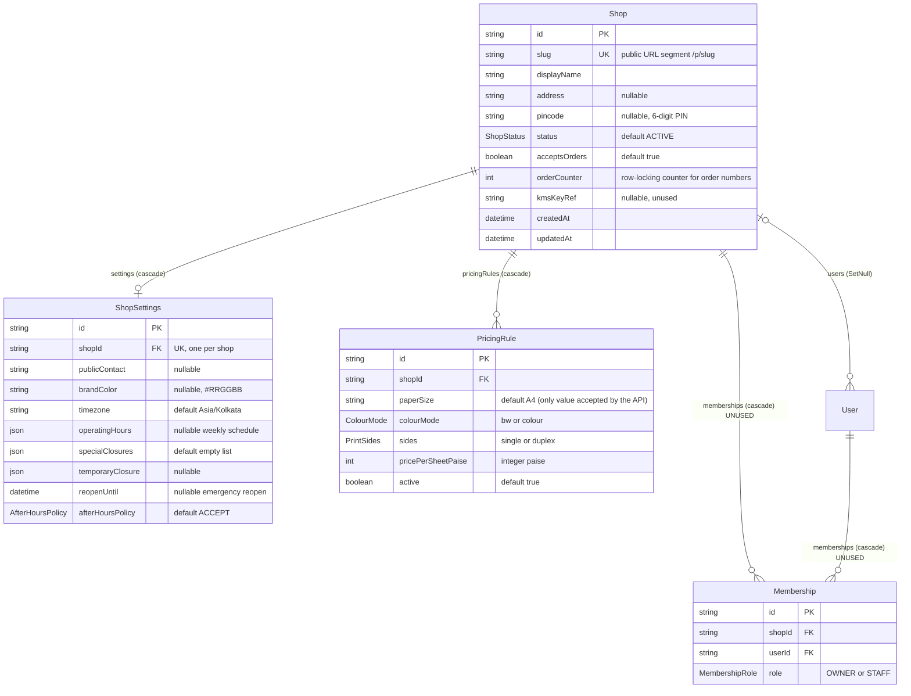

# ER: shop and pricing

Models: `Shop`, `ShopSettings`, `PricingRule`, `Membership` (unused), `User` (for context). Subscription/plan tables are in [er-legacy-billing.md](./er-legacy-billing.md).

## Constraints

| Table | Unique | Foreign keys | Notes |
|---|---|---|---|
| Shop | `slug` | none | Tenant root. `orderCounter` is incremented under the shop row lock when an order is created. |
| ShopSettings | `shopId` | `shopId → Shop` (Cascade) | Created lazily (`upsert`) and with onboarding. |
| PricingRule | `(shopId, paperSize, colourMode, sides)` | `shopId → Shop` (Cascade) | Max 4 effective rules (A4 only): bw/colour × single/duplex. |
| Membership | `(shopId, userId)` | `shopId → Shop`, `userId → User` (Cascade) | **Unused.** Do not treat as authorization. |

## Behaviour that matters to an integrator

- **Pricing rule semantics:** a quote needs an *active* rule matching `(colourMode, sides)`. Sheets = `duplex ? ceil(pages/2) : pages`, times `copies`; total = sheets × `pricePerSheetPaise`. Missing rule → `422 NO_PRICING_RULE`. The cap is 2,000,000,000 paise per order.
- **Rule edits never change existing orders:** `Order.priceSnapshot` / `printOptionsSnapshot` freeze the price at order time (see [er-orders-documents.md](./er-orders-documents.md)). The order endpoint also **recomputes** the price from the shop's *current* active rules; the quote total is not authoritative.
- **Operating hours** live in `ShopSettings` JSON columns (`operatingHours`, `specialClosures`, `temporaryClosure`) interpreted in `timezone`; `afterHoursPolicy = BLOCK` makes the public intake return `409 SHOP_CLOSED` when closed.
- **Open vs accepting:** the public site accepts orders only if `Shop.status = ACTIVE` AND `Shop.acceptsOrders` AND (no subscription OR subscription `ACTIVE`) AND hours allow it.
- **Self-onboarded shops** (since PR #40) are created `ACTIVE` with `acceptsOrders = true`, a `ShopSettings` row, **no** `Subscription`, and **no** pricing rules: the owner must add rules before customers can get a quote (`422 NO_PRICING_RULE`).
