# Full database ER diagram

Source: `apps/api/prisma/schema.prisma` on `origin/main` (`080c6bd`), PostgreSQL 16, 12 migrations (`20261003120000_initial` … `20261023100000_user_profile_onboarding`). **32 models, 14 enums.** Nothing here is invented: every entity, key and relationship is in the schema.

How to read the diagrams: `PK` primary key, `FK` foreign key, `UK` unique. `||--o{` = exactly one → zero-or-more; `|o--o{` = optional parent (nullable FK) → zero-or-more; `||--o|` = one → zero-or-one. Enum-typed columns show the enum name as their type; the enums are listed [below](#enums). The full diagram shows keys only; the domain diagrams carry the important fields.

## Full system diagram (all 32 models, keys only)

> This diagram is deliberately complete and therefore wide (every model hangs off `Shop`/`User`). Zoom in the rendered Markdown (GitHub/VS Code preview); for reading, use the per-domain diagrams linked in the table below, which show the important fields at a legible size.

```mermaid
erDiagram
  direction LR
  Shop ||--o| ShopSettings : "settings"
  Shop ||--o{ PricingRule : "pricingRules"
  Shop |o--o{ User : "users"
  Shop ||--o| Subscription : "subscription"
  Plan ||--o{ Subscription : "plan"
  Shop ||--o{ Membership : "memberships"
  User ||--o{ Membership : "memberships"
  Shop ||--o{ Order : "orders"
  Shop ||--o{ Document : "documents"
  Document ||--o| Order : "one order per document"
  Order ||--o{ OrderStatusHistory : "histories"
  Shop ||--o{ ShopNotification : "notifications"
  Order |o--o{ ShopNotification : "orderId"
  Shop ||--o{ ShopDevice : "devices"
  ShopDevice ||--o{ DevicePrinter : "printers"
  Shop ||--o{ DevicePrinter : "devicePrinters"
  ShopDevice ||--o{ DevicePrintJob : "printJobs"
  DevicePrinter ||--o{ DevicePrintJob : "jobs"
  Shop ||--o{ DevicePrintJob : "devicePrintJobs"
  Shop ||--o{ DevicePairingCode : "pairing codes"
  Shop |o--o{ AuditLog : "auditLogs"
  Shop ||--o{ PrintAgent : "printAgents"
  PrintAgent ||--o{ Printer : "printers"
  Shop ||--o{ Printer : "printers"
  Shop ||--o{ PrintJob : "printJobs"
  Order |o--o| PrintJob : "orderId unique"
  PrintJob |o--o{ Document : "documents"
  Document ||--o| DeletionReceipt : "receipt"
  Shop ||--o{ CustomerSession : "customerSessions"
  Shop ||--o{ Invoice : "invoices"
  Invoice ||--o{ Payment : "payments"
  User ||--o| UserPhoneIdentity : "phoneIdentity"
  User ||--o| UserGoogleIdentity : "googleIdentity"
  User ||--o| AdminTwoFactor : "twoFactor"
  User ||--o{ AdminRecoveryCode : "recoveryCodes"
  User ||--o{ AdminLoginChallenge : "loginChallenges"
  User ||--o{ Session : "sessions"
  User |o--o{ RefreshToken : "refreshTokens"
  User ||--o{ FcmRegistration : "fcmRegistrations"

  Shop { string id PK
    string slug UK }
  User { string id PK
    string shopId FK
    string email UK }
  UserPhoneIdentity { string id PK
    string userId FK
    string firebaseUid UK
    string phoneE164 UK }
  UserGoogleIdentity { string id PK
    string userId FK
    string firebaseUid UK }
  AdminTwoFactor { string userId PK }
  AdminRecoveryCode { string id PK
    string userId FK }
  AdminLoginChallenge { string id PK
    string userId FK
    string tokenHash UK }
  Session { string id PK
    string userId FK
    string tokenHash UK }
  RefreshToken { string id PK
    string userId FK
    string tokenHash UK }
  FcmRegistration { string id PK
    string userId FK
    string tokenHash UK }
  PhoneOnboardingGrant { string id PK
    string tokenHash UK }
  ShopSettings { string id PK
    string shopId FK }
  PricingRule { string id PK
    string shopId FK }
  Plan { string id PK
    string name UK }
  Subscription { string id PK
    string shopId FK
    string planId FK }
  Membership { string id PK
    string shopId FK
    string userId FK }
  Document { string id PK
    string shopId FK
    string printJobId FK
    string objectKey UK }
  Order { string id PK
    string shopId FK
    string documentId FK
    string trackingToken UK }
  OrderStatusHistory { string id PK
    string orderId FK }
  ShopNotification { string id PK
    string shopId FK
    string orderId FK
    bigint seq UK }
  ShopDevice { string id PK
    string shopId FK
    string credentialHash UK }
  DevicePairingCode { string id PK
    string shopId FK
    string codeHash UK }
  DevicePrinter { string id PK
    string shopId FK
    string deviceId FK }
  DevicePrintJob { string id PK
    string shopId FK
    string deviceId FK
    string printerId FK }
  AuditLog { string id PK
    string shopId FK }
  PrintAgent { string id PK
    string shopId FK
    string credentialHash UK }
  Printer { string id PK
    string shopId FK
    string agentId FK }
  PrintJob { string id PK
    string shopId FK
    string orderId FK }
  DeletionReceipt { string id PK
    string documentId FK
    string receiptId UK }
  CustomerSession { string id PK
    string shopId FK
    string tokenHash UK }
  Invoice { string id PK
    string shopId FK }
  Payment { string id PK
    string invoiceId FK }
```

## Model → domain document

| # | Model | Domain doc | In active use on `main`? |
|---|---|---|---|
| 1 | Shop | [shop-pricing](./er-shop-pricing.md) | Yes |
| 2 | ShopSettings | [shop-pricing](./er-shop-pricing.md) | Yes |
| 3 | PricingRule | [shop-pricing](./er-shop-pricing.md) | Yes |
| 4 | Plan | [legacy-billing](./er-legacy-billing.md) | Admin API only |
| 5 | Subscription | [legacy-billing](./er-legacy-billing.md) | Admin API; intake gate |
| 6 | Invoice | [legacy-billing](./er-legacy-billing.md) | **No** (schema only) |
| 7 | Payment | [legacy-billing](./er-legacy-billing.md) | **No** (schema only) |
| 8 | Membership | [shop-pricing](./er-shop-pricing.md) | **No** (schema only; not used for authorization) |
| 9 | User | [auth](./er-auth.md) | Yes |
| 10 | UserPhoneIdentity | [auth](./er-auth.md) | Yes |
| 11 | UserGoogleIdentity | [auth](./er-auth.md) | Yes |
| 12 | Session | [auth](./er-auth.md) | Yes |
| 13 | RefreshToken | [auth](./er-auth.md) | Yes |
| 14 | PhoneOnboardingGrant | [auth](./er-auth.md) | Yes |
| 15 | AdminTwoFactor | [admin-security](./er-admin-security.md) | Yes |
| 16 | AdminRecoveryCode | [admin-security](./er-admin-security.md) | Yes |
| 17 | AdminLoginChallenge | [admin-security](./er-admin-security.md) | Yes |
| 18 | AuditLog | [admin-security](./er-admin-security.md) | Yes |
| 19 | Document | [orders-documents](./er-orders-documents.md) | Yes |
| 20 | Order | [orders-documents](./er-orders-documents.md) | Yes |
| 21 | OrderStatusHistory | [orders-documents](./er-orders-documents.md) | Yes |
| 22 | DeletionReceipt | [orders-documents](./er-orders-documents.md) | **No** (schema only) |
| 23 | CustomerSession | [orders-documents](./er-orders-documents.md) | **No** (schema only) |
| 24 | ShopDevice | [devices-printers](./er-devices-printers.md) | Yes |
| 25 | DevicePairingCode | [devices-printers](./er-devices-printers.md) | Yes |
| 26 | DevicePrinter | [devices-printers](./er-devices-printers.md) | Yes |
| 27 | DevicePrintJob | [devices-printers](./er-devices-printers.md) | Yes |
| 28 | PrintAgent | [devices-printers](./er-devices-printers.md) | **No** (schema only) |
| 29 | Printer | [devices-printers](./er-devices-printers.md) | **No** (schema only) |
| 30 | PrintJob | [devices-printers](./er-devices-printers.md) | **No** (schema only; only `Document.printJobId` points at it) |
| 31 | ShopNotification | [notifications](./er-notifications.md) | Yes |
| 32 | FcmRegistration | [notifications](./er-notifications.md) | Yes |

**8 of the 32 models are schema-only "target architecture" tables** that no route, worker or domain code reads or writes (verified by searching `apps/api/src` for any Prisma call on them): `Invoice`, `Payment`, `Membership`, `DeletionReceipt`, `CustomerSession`, `PrintAgent`, `Printer`, `PrintJob`. The other **24 are in active use**. `Plan` and `Subscription` are used only by the admin API and the order-intake gate.

## Enums

| Enum | Values | Used by |
|---|---|---|
| `Role` | `SHOP_OWNER`, `PLATFORM_ADMIN` | User.role |
| `ShopStatus` | `ACTIVE`, `SUSPENDED`, `PILOT`, `PAST_DUE`, `CANCELLED` | Shop.status. **Only `ACTIVE` and `SUSPENDED` are ever set by application code today**; `PILOT`/`PAST_DUE`/`CANCELLED` are reserved (an admin can set them through `PUT /admin/shops/:id`). |
| `OrderStatus` | `NEW`, `ACCEPTED`, `PRINTING`, `PRINTED`, `READY`, `COLLECTED`, `CANCELLED`, `EXPIRED` | Order.status, OrderStatusHistory |
| `DocumentStatus` | `UPLOADING`, `AVAILABLE`, `PRINTED_RETENTION`, `DELETED`, `FAILED` | Document.status |
| `ColourMode` | `bw`, `colour` | PricingRule.colourMode |
| `PrintSides` | `single`, `duplex` | PricingRule.sides |
| `SubscriptionStatus` | `ACTIVE`, `SUSPENDED`, `CANCELLED` | Subscription.status |
| `AfterHoursPolicy` | `ACCEPT`, `BLOCK` | ShopSettings.afterHoursPolicy |
| `DevicePlatform` | `ANDROID`, `WINDOWS` | ShopDevice.platform |
| `DeviceStatus` | `ACTIVE`, `REVOKED` | ShopDevice.status |
| `MembershipRole` | `OWNER`, `STAFF` | Membership.role |
| `PrintJobStatus` | `UPLOADING`, `QUEUED`, `PRINTING`, `PRINTED`, `FAILED`, `CANCELLED`, `EXPIRED` | PrintJob.status (unused table) |
| `PrinterConnectivity` | `ONLINE`, `OFFLINE`, `ERROR`, `UNKNOWN` | DevicePrinter.connectivity |
| `DevicePrintJobStatus` | `QUEUED`, `CLAIMED`, `DOWNLOADING`, `SUBMITTING`, `SUBMITTED_TO_SPOOLER`, `PRINT_INITIATED`, `FAILED`, `CANCEL_REQUESTED`, `CANCELED`, `NEEDS_RECONCILIATION` | DevicePrintJob.status |

## Logical references that are NOT foreign keys

These columns hold another table's id but have **no FK constraint** in the schema, so the database does not enforce them (and they survive deletion of the target):

| Column | Points at |
|---|---|
| `DevicePrintJob.orderId`, `DevicePrintJob.documentId` | Order, Document |
| `OrderStatusHistory.actorUserId`, `actorDeviceId` | User, ShopDevice |
| `AuditLog.actorUserId`, `actorDeviceId`, `targetId` | User, ShopDevice, polymorphic target |
| `DevicePairingCode.usedByDeviceId`, `createdByUserId` | ShopDevice, User |
| `ShopDevice.revokedByUserId` | User |
| `DevicePrintJob.requestedByUserId`, `resolvedByUserId` | User |
| `Session.familyId` ↔ `RefreshToken.familyId` | the mobile token family (a shared value, not a table) |
| `Session.deviceId`, `RefreshToken.deviceId` ↔ `FcmRegistration.installationId` | the app installation id chosen by the client |
| `RefreshToken.sessionId` | the access `Session` minted with it |
| `PhoneOnboardingGrant.*` | standalone: no relation to any other table (`firebaseUid`, `familyId` are plain strings) |

## Facts for reviewers

- `Shop` is the tenant root. Every shop-scoped table carries `shopId`, except `User.shopId` (nullable, `SetNull`), `AuditLog.shopId` (nullable), and child tables that inherit tenancy through their parent (`OrderStatusHistory`, `Payment`, `AdminRecoveryCode`, ...).
- Delete semantics: orders, documents, print jobs and invoices use `Restrict` (a shop that has them cannot be deleted); settings, pricing, devices, notifications and sessions use `Cascade`.
- A user belongs to exactly one shop (`User.shopId`). `Membership` exists but is **not** used for authorization.
