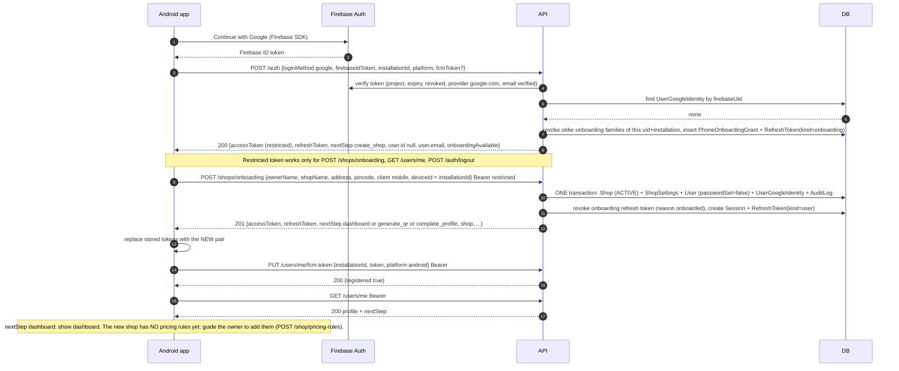
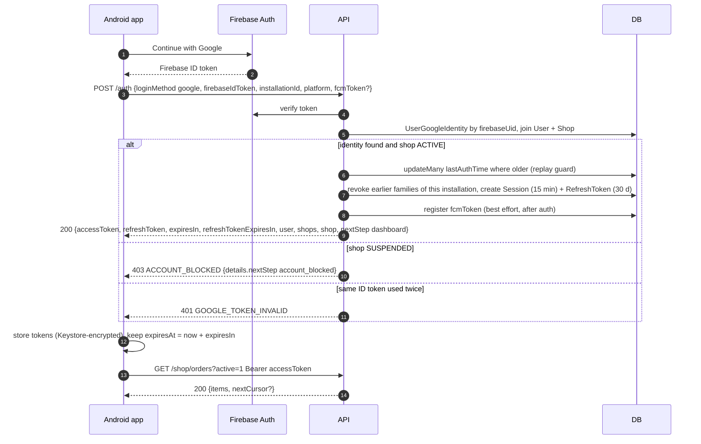
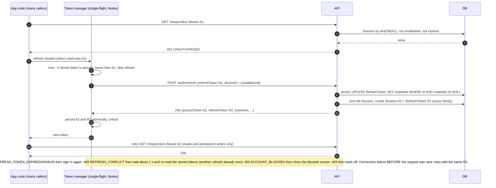
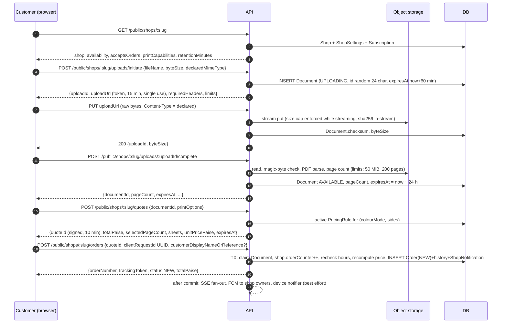
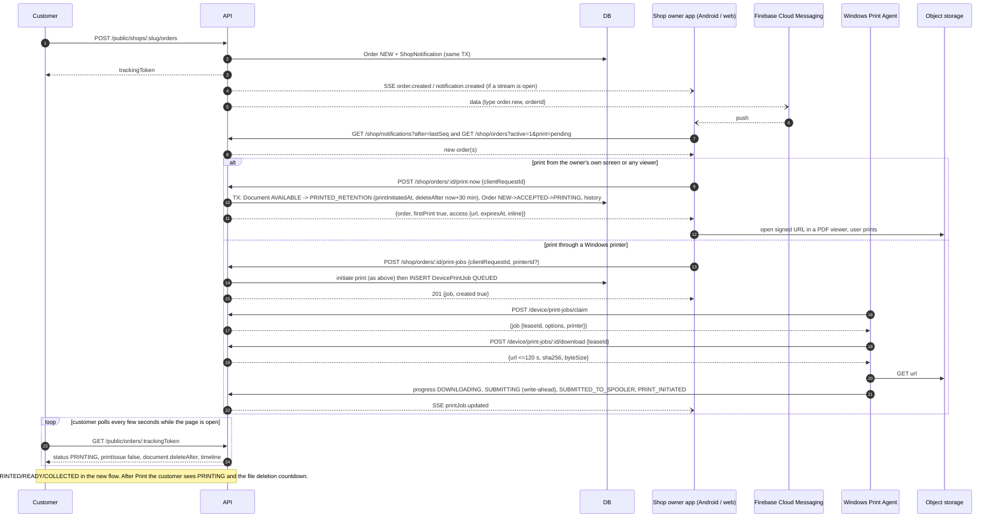
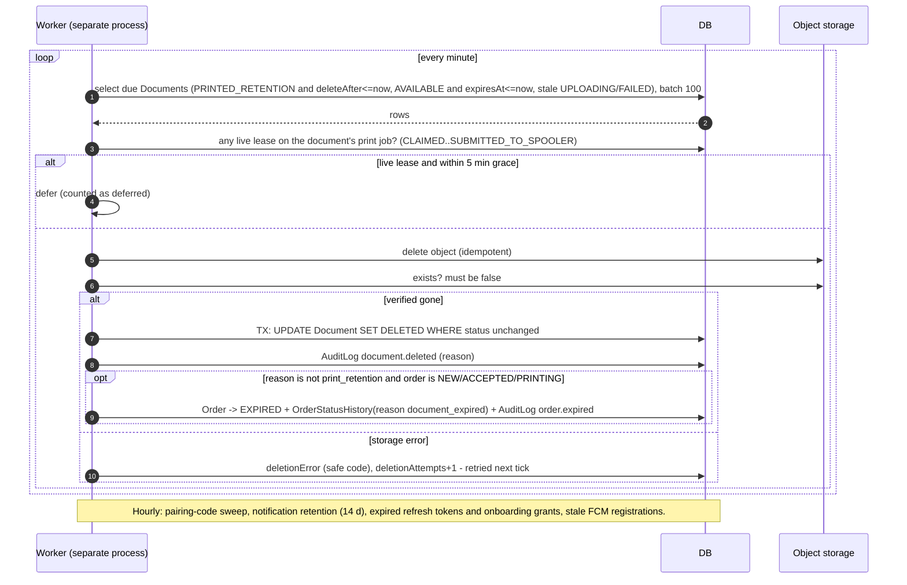
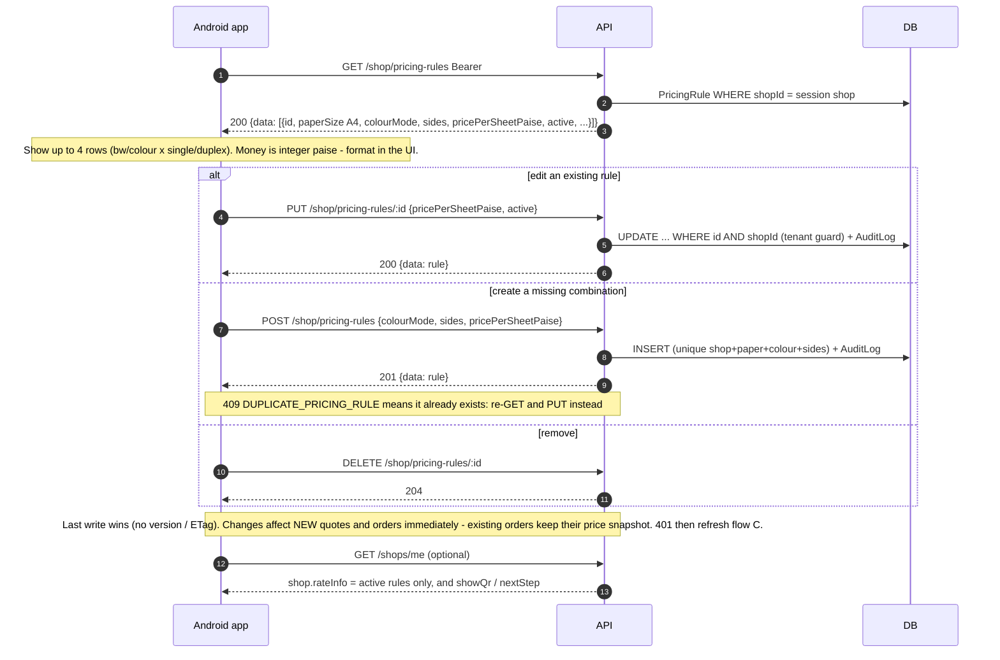

# Sequence diagrams

All flows are transcribed from the route code on `origin/main`. `API` = Fastify (`/api/v1`), `DB` = PostgreSQL, `FB` = Firebase Auth, `Store` = private object storage. Android examples use the **mobile bearer contract**: no cookies, no CSRF header.

## A. New Google user → create shop → dashboard

First-time user: Google proves the identity, but no account exists, so the API issues a **restricted** token pair that can only create the shop.

Failure branches: `403 SELF_ONBOARDING_DISABLED` (feature flag off; the app should show "registration not open"), `409 ALREADY_ONBOARDED`, `409 EMAIL_UNAVAILABLE` (the Google email already belongs to another account: sign in with the existing method and *link* Google from Settings), `429`. A retry of the same onboarding within 2 minutes returns the same shop with `200`.

## B. Existing Google user → authenticate → dashboard

An existing owner whose Google account has **never been linked** gets the restricted pair (as in flow A), *not* a session, even if the Google email equals their account email. They must sign in with their existing method (`loginMethod: "email"` or `"otp"`) and then link Google (`POST /users/me/identities/google`).

## C. Access token expires → refresh → retry safely

Refresh tokens are **single-use** and rotate; two concurrent refreshes would revoke the family if mishandled, so refresh is **single-flight**.

**Lost refresh response (known sharp edge).** The server rotates R1 *before* the response reaches the app. If the response is lost (timeout after the request was sent), the app still holds R1, which is now spent: re-presenting it within `REFRESH_REUSE_GRACE_SECONDS` (5 s) returns `409 REFRESH_CONFLICT`, and later returns `401 REFRESH_TOKEN_INVALID` **and revokes the whole token family**. There is no way to recover the new pair, so the only safe outcome is to sign in again. Keep the refresh call's timeout generous (about 30 s) and treat an unrecoverable refresh as "signed out", not as a crash.

Retry rule for **mutating** calls after a 401: only retry when the request carries an idempotency key (`clientRequestId`) or is naturally idempotent (PUT/DELETE of a known id). `POST /shop/orders/:id/print-now`, `transitions`, `print-jobs` all take a UUID `clientRequestId`: reuse the **same** UUID on retry.

## D. Customer uploads PDF → gets quote → creates order

Customers are anonymous; there is no login. (This is the web flow; an Android customer client would follow the same sequence.)

Repeat the final POST with the same `clientRequestId` and the original order is returned (idempotent).

## E. Shop receives order → prints → customer tracking updates

## F. Document retention expiry → worker deletes file

Orders and metadata are never deleted. API clients see the effect as `document.status = DELETED`, `fileName = null` on the tracking page, and `410 DOCUMENT_UNAVAILABLE` from document-access. The worker cannot push SSE (different process): clients refetch.

## G. Android fetches and edits shop pricing rules

