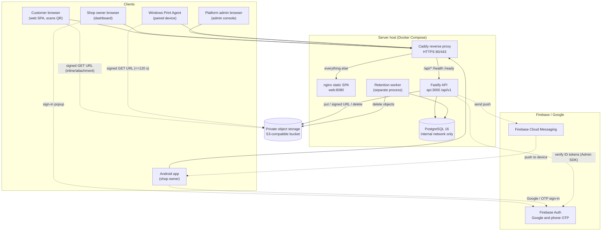
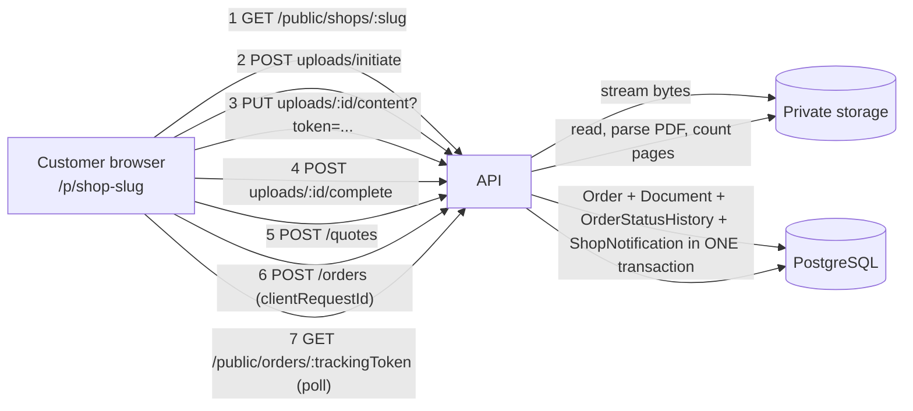
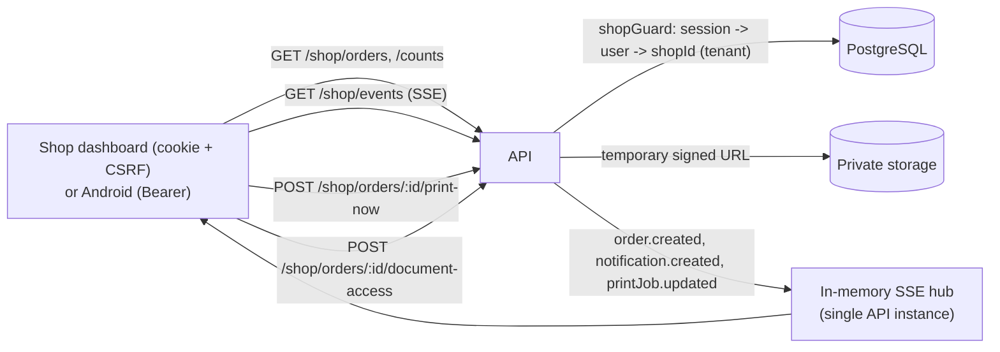
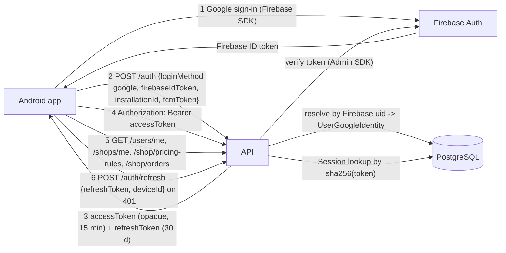
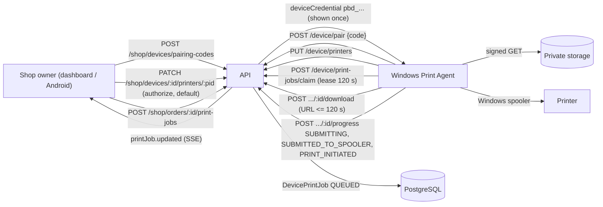
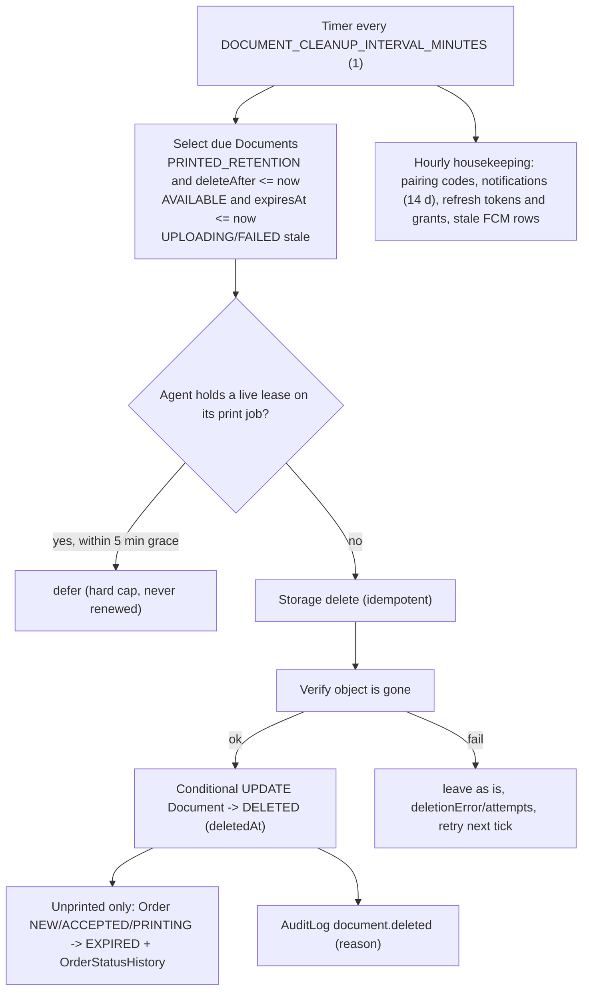

# System architecture

ER diagrams show data relationships only. This document shows **who talks to whom**. Everything is derived from the code and from `deploy/` (Caddy + Docker Compose); items that depend on production configuration are marked **Requires confirmation**.

## 0. Components at a glance

| Component | Technology | Role |
|---|---|---|
| **Deployment proxy** | Caddy (`deploy/Caddyfile`) | The only public listener (80/443). Automatic HTTPS. Routes `/api/*`, `/health`, `/ready` to the API and everything else to the web container. Streams uploads (no request buffering), never buffers SSE, overwrites `X-Forwarded-For`. |
| **Web frontend** | React SPA (`apps/web`), served by nginx (`web:8080`) | Customer pages (`/p/<slug>`, tracking), shop-owner dashboard, admin console. Calls the same `/api/v1`. |
| **API** | Node + Fastify (`apps/api`), single instance, port 3000 | All business logic, auth, signed URLs, SSE hub, FCM sender. Prefix `/api/v1`. |
| **Database** | PostgreSQL 16 (`postgres`, internal network only) | Prisma ORM; 32 models. |
| **Object storage** | S3-compatible private bucket (`STORAGE_DRIVER=s3`) or local disk (`local`) | Customer documents. Never public; reached only through short-lived signed URLs. Production driver: **Requires confirmation**. |
| **Background worker** | Same image, `worker.js` (separate process) | Retention: deletes expired documents, expires orders, sweeps pairing codes, notifications, refresh tokens, grants and FCM rows. Cannot push SSE (separate process). |
| **Windows Print Agent** | Node/PowerShell app (`apps/windows-agent`) | Paired device. Reports printers, leases print jobs, downloads the PDF via signed URL, hands it to the Windows spooler. |
| **Android app** | Kotlin (not in `main`; see below) | Shop-owner app: user Bearer tokens, FCM, optional foreground SSE. |
| **Firebase** | Firebase Auth + FCM (project id from `FIREBASE_PROJECT_ID`) | Sign-in with Google / phone OTP (client SDK) and push delivery. The API verifies ID tokens with the Admin SDK and sends FCM with it. |

> **Branch status.** On `origin/main` (`080c6bd`): web app, API (including Phase A: live queue filters, customer tracking, privacy hardening), Windows agent, worker, mobile auth/profile/FCM APIs, Google sign-up/onboarding (PR #39), free-platform change (PR #40). **Not on `main`:** the Android application source (`feature/daksh-android-companion`, plus `phase3/android*`), and any Phase B work (`feature/daksh-phase-b-smart-print-printers` currently has zero commits beyond `main`). This documentation describes `main` only.

## 1. Whole system

Notes: the browser PUTs uploads to **the API** (`PUT /public/uploads/:id/content`, streamed straight into storage); documents are read back through **signed URLs** pointing at the object store (S3 driver) or at `/api/v1/internal/documents/:key` (local driver).

## 2. Customer web → API → database / storage

## 3. Shop dashboard → API → shop orders

The tenant (`shopId`) is **always derived from the authenticated session**; no shop route accepts a shop id from the client.

## 4. Android app → mobile auth → API → shop data

The Firebase ID token is used **once**, at sign-in. Every later call carries the API's own opaque access token. Firebase ID tokens are not accepted by `/shop/*`, `/users/*` or `/shops/*`.

## 5. Windows Print Agent → device APIs → print-job lifecycle

## 6. Firebase → Google sign-in / FCM → backend

```mermaid
flowchart TB
  subgraph SignIn["Sign-in (identity)"]
    U["User taps Continue with Google"] --> SDK["Firebase Auth SDK (client)"]
    SDK --> TOK["Firebase ID token (about 1 h, auth_time fresh)"]
    TOK --> EX["POST /auth (mobile) or /auth/google/session (web)"]
    EX --> VER["Admin SDK verifies: project, signature, expiry, revocation, provider google.com, Google-verified email, auth_time freshness"]
    VER --> RES{"UserGoogleIdentity for this Firebase uid?"}
    RES -->|"yes"| SESS["Session / Bearer pair"]
    RES -->|"no"| REST["Restricted onboarding principal (nextStep create_shop)"]
  end
  subgraph Push["Push (notifications)"]
    TKN["Android obtains FCM token"] --> REG["PUT /users/me/fcm-token {installationId, token, platform}"]
    REG --> ENC["Stored AES-256-GCM encrypted + sha256 hash"]
    ORD["Customer creates order (committed)"] --> SEND["notifyShopOwners: FCM data {type order.new, orderId} + generic title"]
    ENC --> SEND
    SEND --> DEV["Android receives push, then fetches /shop/orders and /shop/notifications with its own token"]
  end
```

## 7. Worker → file retention → object storage cleanup

## 8. Trust boundaries

| Boundary | Enforced by |
|---|---|
| Internet → API | Caddy TLS, per-IP rate limits, body-size caps, Helmet headers, CORS limited to `WEB_ORIGIN` (browsers only: native apps are unaffected) |
| Tenant isolation | `shopId` from session/device row; every query includes it; foreign ids are indistinguishable from unknown ids (404) |
| Database | Postgres on an `internal: true` Docker network (no route to the internet, no published port) |
| Storage | Bucket is private; only the API and worker hold credentials; clients get ≤300 s signed URLs bounded by the document's retention deadline |
| Worker | Separate process and container with only storage-egress network access |
