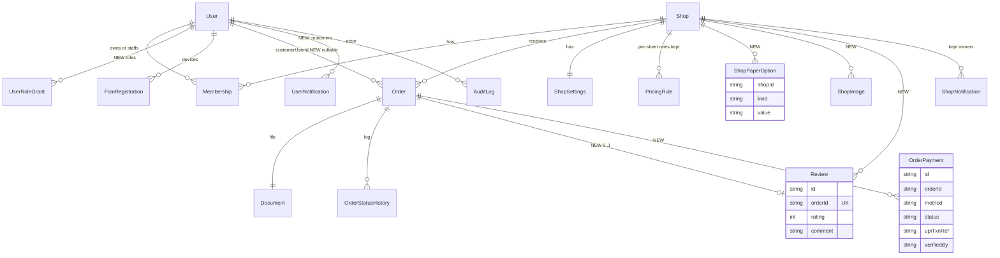

# 03 – Target ER diagram (proposed, additive over the current schema)

Entities marked NEW do not exist today. Existing models gain only nullable columns.

New nullable columns: `Shop` (phone, email, city, state, country, latitude, longitude, isVerified, verifiedAt, verifiedBy, upiId, acceptedPaymentMethods, ratingAvg, ratingCount); `Order` (customerUserId, paymentMethod, paymentStatus, note, paperType, acceptedAt, completedAt, isReviewed); `User` (name parts, address, latitude, longitude, isActive, email nullable).

Unchanged infrastructure (see `docs/architecture/full-er-diagram.md` on PR #44): Session, RefreshToken, AdminTwoFactor, AdminRecoveryCode, AdminLoginChallenge, UserGoogleIdentity, UserPhoneIdentity, PhoneOnboardingGrant, ShopDevice, DevicePairingCode, DevicePrinter, DevicePrintJob, PrintAgent, Printer, PrintJob, DeletionReceipt, CustomerSession, Plan, Subscription, Invoice, Payment.
