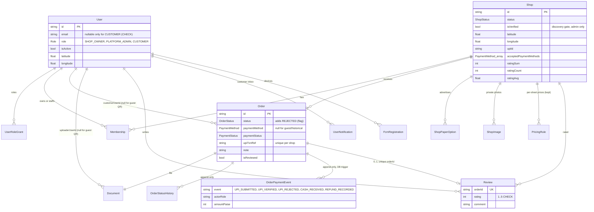
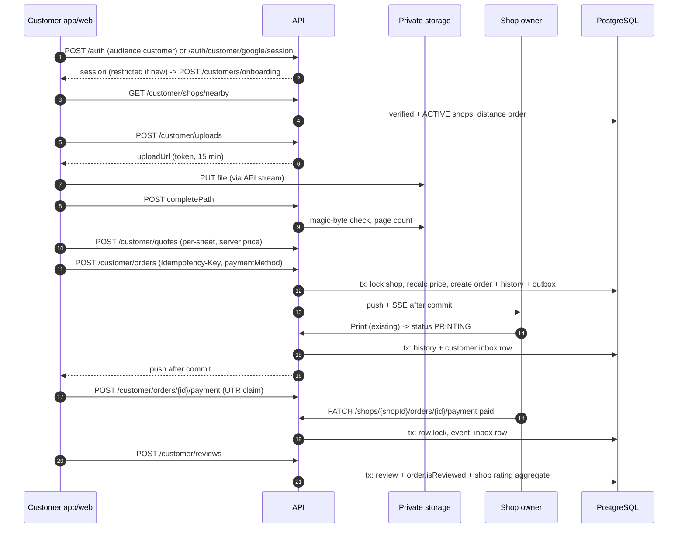
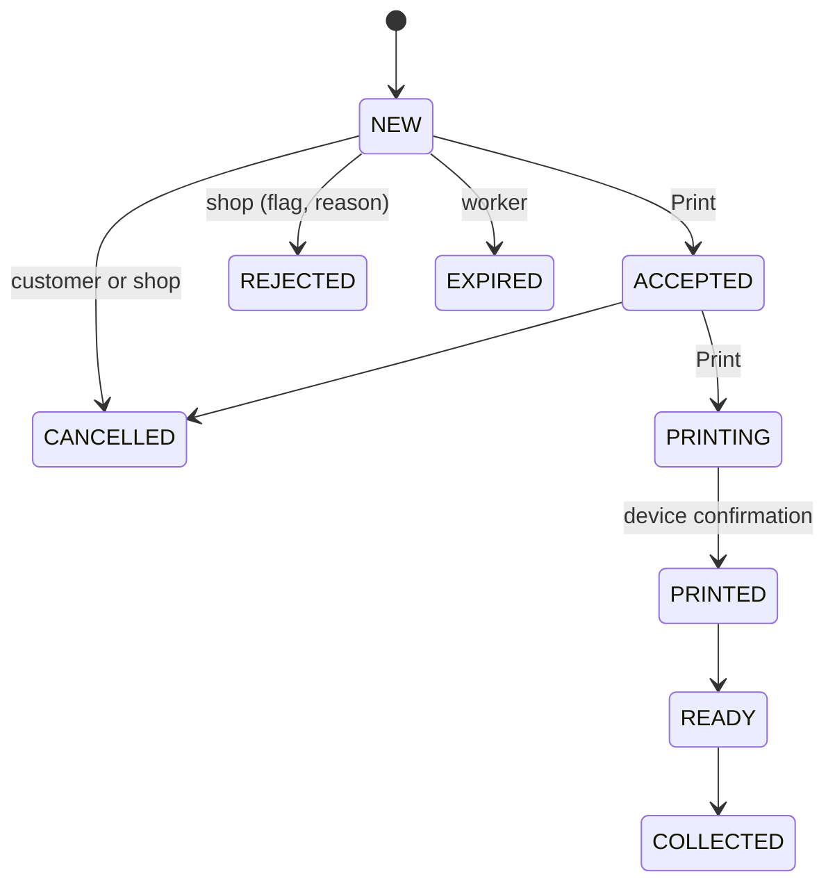
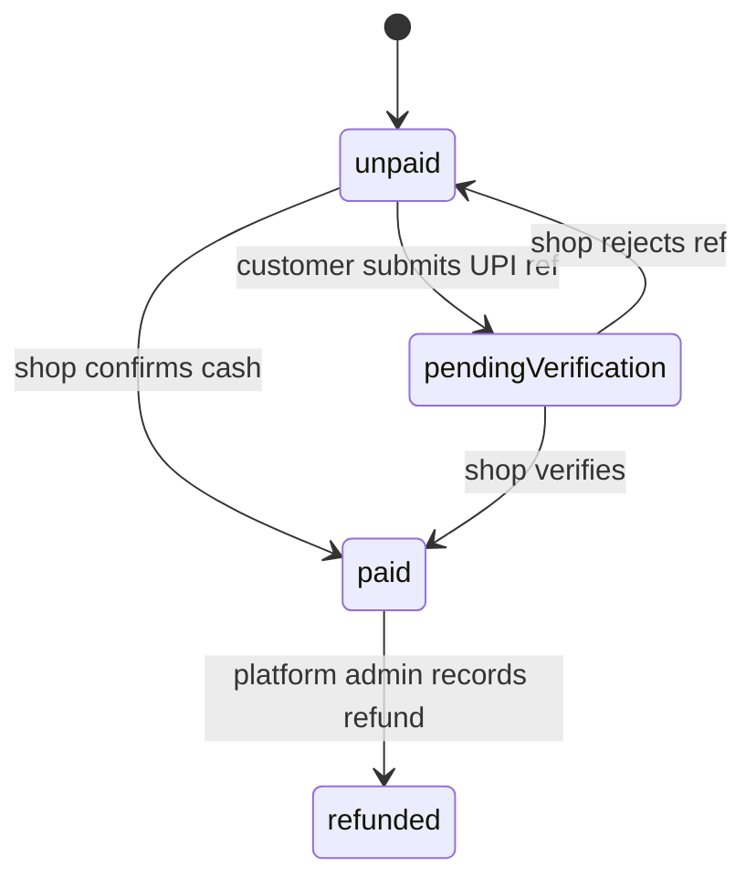
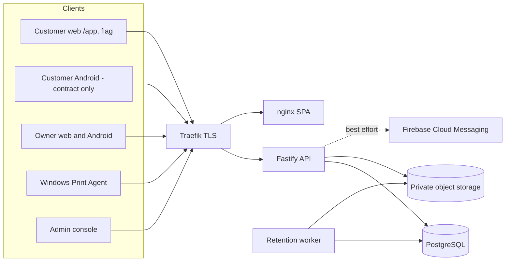

# 13 – Final ER and sequence diagrams (as implemented)

Source of truth: `apps/api/prisma/schema.prisma` and the migrations `20261028100000` to `20261028140000`. Status per `IMPLEMENTATION_PROGRESS.md`.

## Entity relationships added by Schema V2

## Customer order, payment and review

## Order status and payment status (independent)

## System overview

